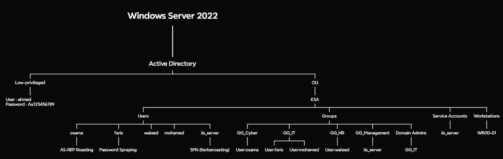

# AD-Home-Lab

## Download the Project

> **Important:** Run the following steps directly on the Windows Server machine as Administrator.  
> This lab is designed to be deployed on Windows Server to install and configure Active Directory Domain Services.

Run the following PowerShell command:

```powershell
Invoke-WebRequest "https://github.com/bex2030/AD-Home-Lab/archive/refs/heads/main.zip" -OutFile "$env:USERPROFILE\Desktop\AD-Home-Lab.zip"
```

After the download is complete:

1. Open your user profile folder.
2. Extract `AD-Home-Lab.zip`.
3. Open the extracted `AD-Home-Lab` folder.
4. Run the PowerShell deployment scripts as Administrator.

---

## Deployment

Run the PowerShell scripts in the following order:

```text
0-Rename-Server.ps1
01-Install-ADDS.ps1
02-Create-OUs.ps1
03-Create-Users.ps1
04-Create-Groups.ps1
05-Create-ServiceAccounts.ps1
06-Register-SPNs.ps1
07-Add-GroupMembers.ps1
08-Create-SMB-Shares.ps1
09-Disable-Defender-Firewall.ps1
```

> **Note:**
>
> - `0-Rename-Server.ps1` automatically renames the server and restarts Windows.
> - `01-Install-ADDS.ps1` installs Active Directory Domain Services, creates the domain, and automatically restarts Windows.
> - After both automatic restarts, continue running the remaining scripts in numerical order.

---

## Download Wordlists (Windows)

Clone the repository using Git:

```powershell
git clone https://github.com/bex2030/AD-Home-Lab.git
cd AD-Home-Lab\Wordlists
```

The directory contains:

- `default_credentials.txt`
- `users.txt`
- `passwords.txt`

### Wordlist Details

These wordlists are custom-built for this lab and intended to be used from the Windows attack machine during the enumeration and password spraying phases.

- `default_credentials.txt` — contains the default username and password used to initially authenticate to the domain, representing the attacker's starting point of access in the lab scenario.
- `users.txt` — matches the domain usernames created during deployment (`ahmed`, `faris`, `mohamed`, `waleed`, `osama`), used as a target list for username enumeration and password spraying.
- `passwords.txt` — contains a small, lab-specific list of weak passwords assigned to lab accounts, simulating password reuse and weak password practices.

> **Note:**
>
> These wordlists are intentionally small and scenario-specific rather than general-purpose lists like `rockyou.txt`. They are provided to make the lab reproducible for learning purposes.

---

## Create a Local Windows Account (No Microsoft Account)

During Windows 10/11 setup, open **Command Prompt** (`Shift + F10`) and run:

```cmd
start ms-cxh:localonly
```

This opens the local account creation wizard and allows Windows to be configured without signing in with a Microsoft account.

---

# Architecture



---


# Overview

AD-Home-Lab is a PowerShell-based Active Directory lab that automatically deploys a Windows Server environment for learning and practicing Active Directory administration, enumeration, and penetration testing.

The lab uses a Windows-based attack machine to perform Active Directory security assessments and simulate common attack scenarios in a controlled environment.

The lab includes:

- Automated Active Directory deployment
- Organizational Units (OUs)
- Users and Groups
- Service Accounts and SPNs
- SMB Shares
- Custom wordlists for password spraying
- Windows-based penetration testing tools
- Attack scenarios such as Password Spraying, AS-REP Roasting, Kerberoasting, LDAP Enumeration, SMB Enumeration, and BloodHound analysis

---

## Attack Flow

```text
ahmed
   |
   v
SMB Enumeration
   |
   v
support_notes.txt
   |
   v
Credential Discovery
   |
   v
Password Spraying
   |
   v
faris
   |
   v
GG_IT
   |
   v
Domain Admins

----------------------------

SPN Enumeration
       |
       v
Kerberoasting
       |
       v
Offline Password Cracking
       |
       v
iis_server

----------------------------

AS-REP Roasting
   |
   v
osama
```

---

# Table of Contents

- [Quick Start](#quick-start)
  - [Download the Project](#download-the-project)
  - [Deployment](#deployment)
  - [Download Wordlists (Windows)](#download-wordlists-windows)
  - [Create a Local Windows Account (No Microsoft Account)](#create-a-local-windows-account-no-microsoft-account)
- [Architecture](#architecture)
- [Overview](#overview)
- [Attack Flow](#attack-flow)
- [Features](#features)
- [Lab Environment](#lab-environment)
- [Hardware Requirements](#hardware-requirements)
- [Virtual Machine Resources](#virtual-machine-resources)
- [Network Configuration](#network-configuration)
- [Domain Information](#domain-information)
- [Active Directory Structure](#active-directory-structure)
- [Services](#services)
- [Lab Scenario](#lab-scenario)
- [Attack Scenarios](#attack-scenarios)
- [Defensive Concepts](#defensive-concepts)
- [Tools Used](#tools-used)
- [Learning Outcomes](#learning-outcomes)
- [Future Improvements](#future-improvements)
- [Screenshots](#screenshots)
- [Author](#author)

---

# Features

- Automated Active Directory Deployment
- PowerShell Automation
- Organizational Units (OUs)
- Users and Security Groups
- Nested Active Directory Groups
- Service Accounts
- Kerberos SPN Configuration
- Domain-Joined Workstations
- Windows-Based Attack Machine
- IIS Web Server
- SMB Shares
- Credential Exposure Scenario
- Password Spraying
- Password Reuse
- LDAP Enumeration
- SMB Enumeration
- Kerberoasting
- AS-REP Roasting
- BloodHound Attack Path Analysis
- Enterprise-Style Active Directory Environment

---


---

# Lab Environment

| Machine | Operating System | Role |
|----------|------------------|------|
| DC-01 | Windows Server 2022 | Domain Controller |
| WIN10-01 | Windows 10 | Domain Client |
| WIN11-ATTACKER | Windows 11 | Attack Machine |

---

# Hardware Requirements

| Component | Recommended |
|------------|-------------|
| CPU | 4 Cores |
| RAM | 16 GB |
| Storage | 100 GB |
| Hypervisor | VMware Workstation Pro |
| Network | NAT |

---

# Virtual Machine Resources

## DC-01

```text
CPU: 2 Cores
RAM: 4 GB
Storage: 60 GB
```

## WIN10-01

```text
CPU: 2 Cores
RAM: 2 GB
Storage: 40 GB
```

## WIN11-ATTACKER

```text
CPU: 2 Cores
RAM: 4 GB
Storage: 60 GB
```

### Lab Purpose

- Internal Security Assessment
- Active Directory Enumeration
- Windows-Based Attack Simulation
- Active Directory Penetration Testing
- Privilege Escalation Analysis

---

# Network Configuration

| Setting | Value |
|---------|-------|
| Hypervisor | VMware Workstation Pro |
| Network Mode | NAT |
| IP Assignment | VMware DHCP |

All virtual machines obtain their IP addresses automatically from VMware DHCP.

> **Important:**
>
> The `WIN11-ATTACKER` machine operates independently and is not joined to the `cyber.local` domain.
>
> All machines must be connected to the same virtual network to communicate with each other.

---

# Domain Information

| Setting | Value |
|---------|-------|
| Domain | `cyber.local` |
| NetBIOS | `CYBER` |

---

# Deployment

Run the following PowerShell scripts from an elevated PowerShell session on the Domain Controller in the following order.

> **Note**
>
> Run **0-Rename-Server.ps1** first. The server will automatically restart after the computer name is changed.
>
> After Windows starts again, run **01-Install-ADDS.ps1**. Active Directory will be installed, the domain will be created, and the server will automatically restart again.
>
> Once the second restart is complete, continue running the remaining scripts in numerical order.

---

```powershell
0-Rename-Server.ps1
01-Install-ADDS.ps1
02-Create-OUs.ps1
03-Create-Users.ps1
04-Create-Groups.ps1
05-Create-ServiceAccounts.ps1
06-Register-SPNs.ps1
07-Add-GroupMembers.ps1
08-Create-SMB-Shares.ps1
09-Disable-Defender-Firewall.ps1
```

---

# Active Directory Structure

```text
cyber.local

└── KSA
    ├── Users
    │   ├── ahmed
    │   ├── faris
    │   ├── mohamed
    │   ├── waleed
    │   └── osama
    │
    ├── Groups
    │   ├── GG_IT
    │   ├── GG_HR
    │   ├── GG_Cyber
    │   └── GG_Management
    │
    ├── Service Accounts
    │   └── iis_server
    │
    └── Workstations
        └── WIN10-01
```

> **Note:**
>
> `WIN11-ATTACKER` is a standalone Windows machine and is not part of the Active Directory domain. It is used to perform enumeration and penetration testing against the `cyber.local` environment.

---

# Services

## Active Directory

- User Management
- Group Management
- Organizational Units (OUs)
- Kerberos Authentication
- Security Groups

## DNS

- Forward Lookup Zone
- Domain Name Resolution
- Client Domain Joining
- Active Directory DNS Resolution

## IIS

| Setting | Value |
|---------|-------|
| Website | CyberLab |
| Port | 80 |
| Service Account | `CYBER\iis_server` |

## SMB File Shares

| Share | Permission |
|--------|------------|
| IT | GG_IT |
| HR | GG_HR |
| Cyber | GG_Cyber |
| Management | GG_Management |

> **Note**
>
> The **IT** share grants read-only access to the **ahmed** account and contains a sample file (`support_notes.txt`) to simulate an internal credential exposure scenario used during Active Directory enumeration.

---

# Lab Scenario

This lab simulates an internal Active Directory security assessment using a standalone Windows attack machine.

The attacker uses `WIN11-ATTACKER` to interact with the `cyber.local` environment and perform security assessments against Active Directory, domain accounts, authentication services, and SMB resources.

The lab demonstrates common Active Directory attack techniques, including credential discovery, password spraying, Kerberoasting, AS-REP Roasting, LDAP enumeration, and privilege escalation through misconfigured group memberships.


## Phase 1 – Initial Access

The assessment begins with the compromised credentials of **ahmed**, a low-privileged domain user.

```text
Username: ahmed
Password: Aa123456789
```

The attacker uses a standalone Windows 11 machine (`WIN11-ATTACKER`) to connect to and assess the Active Directory environment.

---

## Phase 2 – SMB Enumeration

Using the compromised **ahmed** account, the attacker enumerates accessible SMB shares from the Windows attack machine.

The **IT** share contains an internal support note that was accidentally left behind after a password reset.

The note reveals the temporary password assigned to the **faris** account.

```text
\\DC-01\IT
        |
        v
support_notes.txt
        |
        v
Username: faris
Password: Aa123456789
```

### Demonstrates

- SMB Enumeration
- Credential Discovery
- Insecure Credential Storage

---

## Phase 3 – Password Spraying

Using the password discovered in the IT support note, the attacker performs password spraying against the domain user accounts.

The assessment identifies password reuse between **ahmed** and **faris**, as both accounts share the same password.

```text
support_notes.txt
        |
        v
Password Spraying
        |
        v
Credential Validation
        |
        +---- ahmed
        |
        +---- faris
                 |
                 v
               GG_IT
                 |
                 v
           Domain Admins
```

The **faris** account is selected for further exploitation because **GG_IT** is nested inside **Domain Admins**, resulting in effective **Domain Administrator** privileges.

### Demonstrates

- Password Spraying
- Password Reuse
- Credential Validation
- Nested Group Privilege Escalation

---

## Phase 4 – Kerberoasting

The **iis_server** service account is configured with an HTTP Service Principal Name (SPN).

From the Windows attack machine, the attacker enumerates Service Principal Names (SPNs), requests a Kerberos service ticket for the **iis_server** account, and performs offline password cracking to recover the service account credentials.

```text
Username: iis_server
Password: Password123!
```

### Demonstrates

- SPN Enumeration
- Kerberoasting
- Offline Password Cracking

---

## Phase 5 – AS-REP Roasting

The **osama** account has Kerberos pre-authentication disabled.

From the Windows attack machine, the attacker performs an AS-REP Roasting attack to obtain an AS-REP hash for the **osama** account without prior knowledge of the user's password.

After cracking the hash offline, the attacker recovers the account credentials.

```text
Username: osama
Password: Pass0rd1
```

### Demonstrates

- AS-REP Roasting
- Kerberos Enumeration
- Offline Password Cracking

---


# Attack Scenarios

The lab supports the following attack scenarios using a standalone Windows attack machine:

- Active Directory Enumeration
- LDAP Enumeration
- SMB Enumeration
- SMB Share Discovery
- User Enumeration
- Credential Discovery
- Insecure Credential Storage
- Password Spraying
- Password Reuse
- SPN Enumeration
- Kerberoasting
- AS-REP Roasting
- PowerView Enumeration
- SharpHound Data Collection
- BloodHound Analysis
- SMB Permission Testing
- Nested Group Privilege Escalation

---

# Defensive Concepts

The lab also demonstrates the following defensive concepts:

- Least Privilege
- Security Groups
- Nested Group Management
- Service Account Management
- SMB Permissions
- Password Policies
- Credential Protection
- Kerberos Authentication
- Active Directory Hardening
- Windows Firewall
- Security Auditing

---

# Tools Used

## Infrastructure

- VMware Workstation Pro
- Windows Server 2022
- Windows 10
- Windows 11
- PowerShell

## Windows-Based Enumeration

- PowerShell — System Administration & Active Directory Enumeration
- Active Directory PowerShell Module — User, Group & Domain Enumeration
- PowerView — Active Directory Enumeration
- Nmap — Network Discovery & Service Enumeration
- Windows SMB PowerShell Cmdlets — SMB Share Enumeration
- SharpHound — Active Directory Data Collection

## Active Directory & Kerberos

- BloodHound — Active Directory Attack Path Analysis
- PowerView — Active Directory Enumeration
- SharpHound — BloodHound Data Collection
- Rubeus — Kerberos Ticket Operations
- Mimikatz — Credential Extraction & Kerberos Attacks

## Offensive Security

- Impacket — Kerberos, SMB & Remote Execution
- NetExec — Network Enumeration & Authentication Testing
- Hashcat — Password Hash Cracking
- John the Ripper — Offline Password Cracking

> **Note:**
>
> The primary attack environment is Windows 11. Some tools may require additional dependencies, such as Python or other runtime components, before they can be used on Windows.

---

# Learning Outcomes

After completing this project, you will gain hands-on experience with:

- Deploying Active Directory using PowerShell
- Windows Server Administration
- Active Directory Management
- Organizational Units (OUs)
- Security Groups
- SMB Configuration
- Kerberos Authentication
- Windows-Based Penetration Testing
- Active Directory Enumeration
- LDAP Enumeration
- SMB Enumeration
- Credential Discovery
- Password Spraying
- Password Reuse Assessment
- Kerberoasting
- AS-REP Roasting
- BloodHound Data Collection & Analysis
- Privilege Escalation Techniques
- Active Directory Attack Path Analysis

---

# Future Improvements

- Group Policy (GPO)
- SQL Server
- Active Directory Certificate Services (AD CS)
- Sysmon
- Microsoft Defender
- LAPS
- Windows Event Forwarding (WEF)
- Wazuh SIEM Integration
- Elastic Stack Integration

---

# Screenshots

## Active Directory Users and Computers


## SMB Enumeration


## Password Spraying


## Kerberoasting


## AS-REP Roasting


## BloodHound


## IIS Website


## Domain Join


## Windows Attack Machine


---

# Author

**Osama Aljohani**

## Certifications

- eCPPTv3
- eWPTXv3
- eWPTv2
- eJPTv2
